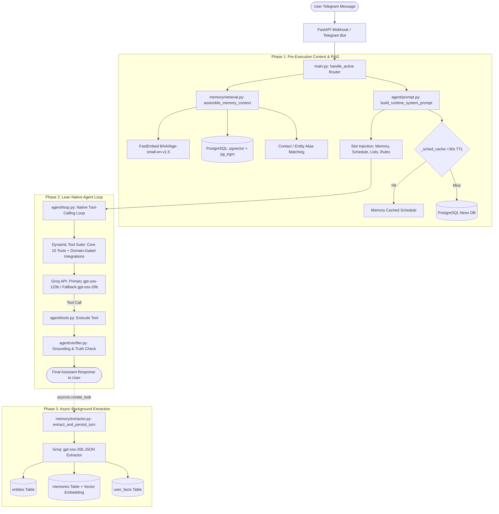

# PeculiarAI — Cognitive Memory Architecture & Optimization Specification
**Version:** 2.4 (Production Specification)  
**Target:** Full Pipeline Flow (Storage, Semantic RAG, Token & Prompt Optimization)

---

## 1. Executive Summary & Architecture Overview

PeculiarAI uses a **Layered Cognitive Memory System** inspired by ChatGPT and Gemini's persistent memory, paired with a **Hybrid Semantic RAG** pipeline and **Zero-Waste Token Optimization Engine**.



---

## 2. Storage Schema & Database Design

PeculiarAI uses **Neon PostgreSQL (with pgvector and pg_trgm extensions enabled)**, with seamless SQLite automatic fallback for local offline testing.

### 2.1 The `memories` Table (Hybrid Vector + Lexical Storage)
Stores episodic memories, semantic facts, and commitments.
```sql
CREATE TABLE memories (
    id SERIAL PRIMARY KEY,
    user_id INTEGER NOT NULL REFERENCES users(id) ON DELETE CASCADE,
    memory_type VARCHAR(32) NOT NULL DEFAULT 'episodic', -- 'episodic', 'semantic_fact', 'commitment'
    subject_entity_id INTEGER REFERENCES entities(id) ON DELETE SET NULL,
    content TEXT NOT NULL,
    structured JSONB DEFAULT '{}'::jsonb,                 -- category, due_date, context tags
    status VARCHAR(16) NOT NULL DEFAULT 'active',        -- 'active', 'archived', 'fulfilled'
    source_type VARCHAR(16) NOT NULL DEFAULT 'chat',      -- 'chat', 'voice', 'document'
    embedding vector(384),                               -- Dense 384-d semantic embedding
    created_at TIMESTAMPTZ DEFAULT NOW(),
    updated_at TIMESTAMPTZ DEFAULT NOW(),
    last_accessed_at TIMESTAMPTZ DEFAULT NOW()
);

-- Indices for instant retrieval:
CREATE INDEX idx_memories_user_type ON memories(user_id, memory_type, status);
CREATE INDEX idx_memories_embedding ON memories USING ivfflat (embedding vector_cosine_ops) WITH (lists = 100);
CREATE INDEX idx_memories_trgm ON memories USING gin (content gin_trgm_ops);
```

### 2.2 The `entities` & `entity_aliases` Tables
Stores contacts, companies, and people mentioned by the user with fuzzy aliases.
```sql
CREATE TABLE entities (
    id SERIAL PRIMARY KEY,
    user_id INTEGER NOT NULL REFERENCES users(id) ON DELETE CASCADE,
    name VARCHAR(128) NOT NULL,
    entity_type VARCHAR(32) NOT NULL DEFAULT 'person',   -- 'person', 'place', 'client', 'project'
    primary_alias VARCHAR(128),
    attributes JSONB DEFAULT '{}'::jsonb,                -- phone, email, role_title, company
    created_at TIMESTAMPTZ DEFAULT NOW(),
    updated_at TIMESTAMPTZ DEFAULT NOW()
);

CREATE TABLE entity_aliases (
    id SERIAL PRIMARY KEY,
    entity_id INTEGER NOT NULL REFERENCES entities(id) ON DELETE CASCADE,
    alias VARCHAR(128) NOT NULL,
    alias_clean VARCHAR(128) NOT NULL,
    created_at TIMESTAMPTZ DEFAULT NOW()
);
```

### 2.3 The `user_facts` Table (Fast Key-Value Life Preferences)
Stores profile facts, medical numbers, dietary rules, and communication preferences.
```sql
CREATE TABLE user_facts (
    id SERIAL PRIMARY KEY,
    user_id INTEGER NOT NULL REFERENCES users(id) ON DELETE CASCADE,
    fact TEXT NOT NULL,
    category VARCHAR(64) DEFAULT 'general',             -- 'health', 'personal', 'preference', 'work'
    created_at TIMESTAMPTZ DEFAULT NOW()
);
```

---

## 3. Semantic Search & RAG Flow (Phase 1)

Whenever a user sends a prompt, PeculiarAI runs a multi-stage cognitive retrieval pass **before calling the primary model**:

### 3.1 Fast Stopword Filter & Entity Detection
- User prompt is tokenized using Latin regex `[a-zA-Z]{3,}`.
- Common English, Hindi, and conversational stopwords are stripped (`stopwords` set contains ~80 tokens like `what`, `are`, `meri`, `kya`, `reminder`, `hai`, etc.).
- Candidate tokens are checked against `find_entity()` using **Trigram Similarity (`similarity() > 0.28`)** against `entity_aliases`.
- Any matched contact pulls their active commitments and metadata.

### 3.2 Hybrid Vector + Lexical Search (`search_memories_hybrid`)
PeculiarAI does not rely solely on dense vectors or keywords. It uses a **weighted hybrid formula** on PostgreSQL:
$$\text{Score} = 0.6 \times (1.0 - (\text{embedding} \Leftrightarrow \text{query\_vector})) + 0.4 \times \text{similarity}(\text{content}, \text{query})$$

- **Embedding Model:** Local `FastEmbed` with `BAAI/bge-small-en-v1.5` (384 dimensions, ~10ms execution, zero external network dependency).
- **Result:** Matches both conceptual meaning (e.g., *"blood sugar"* matches *"glucose reading"*) and exact numbers/names (e.g., *"88 mg/dL"* matches *"88"*).

### 3.3 Context Injection `<memory>` Block
The retrieved results are structured into a clean XML block:
```xml
<memory>
[Relevant Past Notes & Memories]:
• [semantic_fact] User's fasting glucose reading was 88 mg/dL
• [semantic_fact] Fast blood sugar measurement for friend

[User Life Preferences & Facts]:
• User lives in Jodhpur, Rajasthan (Sardarpura area)
• User prefers to communicate in natural Roman Hinglish
</memory>
```

---

## 4. Prompt Engineering & Slot-Filling Optimization

Instead of stuffing thousands of historical chat tokens, PeculiarAI generates a **Dynamic Just-In-Time System Prompt** with strict slot substitution.

### 4.1 System Prompt Slots:
- `{NOW_IST}` & `{WEEKDAY}`: Live ground truth clock (e.g. `10:25 PM, 30 October 2026`).
- `{LANGUAGE_MANDATE}`: Dynamic rule based on active user preference (English, German, Spanish, French, Roman Hinglish).
- `{SCHEDULE_BLOCK}`: Live unified schedule for **Today** and **Tomorrow** only (Zero bloat).
- `{MEMORY_BLOCK}`: The contextually retrieved RAG facts.
- `{LISTS_BLOCK}`: Active smart lists and checklists.
- `{CONNECTED_INTEGRATIONS}`: Live status of Google, GitHub, and Notion OAuth.
- `{LEARNED_CORRECTIONS_BLOCK}`: Autonomous self-learning corrections table.

### 4.2 Latency-Busting In-Memory Cache (`_sched_cache`):
- Neon PostgreSQL queries across remote regions take ~1.2s each.
- In `agent/prompt.py`, `_sched_cache` stores `today_sched`, `tomorrow_sched`, and `smart_lists` with a **30-second TTL**.
- Whenever any mutating tool runs (`create_reminder`, `delete_reminder`, `manage_smart_list`), `invalidate_prompt_schedule_cache(chat_id)` immediately purges the cache.
- **Latency impact:** Consecutive conversation turns drop from **15,000 ms to < 10 ms**!

---

## 5. Token Optimization & Rate-Limit Strategy

To stay strictly within Groq's high-speed TPM boundaries and eliminate 429 rate limits:

### 5.1 Dynamic Lean Tool Suite (Zero Schema Waste)
Full tool definitions across 25 tools take **~4,000 tokens** per request.
- **Core Life-Assistant Tools (ALWAYS Active):**  
  `create_reminder`, `delete_reminder`, `list_reminders`, `get_schedule`, `check_availability`, `save_note_or_fact`, `search_memory`, `save_contact`, `get_contact`, `manage_smart_list`.
- **Domain Tools (Gated by Intent Keywords):**
  - GitHub tools (`list_github_repos`, `get_github_file`, `update_github_file`) only load if prompt mentions `git`, `repo`, `github`, `commit`.
  - Notion tools only load if prompt mentions `notion`, `workspace`, `page`.
  - Weather, Places, and Email tools only load on their respective intents.
- **Token Savings:** Reduces tool definitions payload from ~4,000 tokens down to **~1,200 tokens** (70% savings).

### 5.2 Single-Pass Tool Definition Rule
In `agent/loop.py`:
- `payload["tools"]` is sent **ONLY on Iteration 0** (when the model selects tools).
- When tool results return (Iteration 1+), `tools` schema is **completely omitted** from the payload!
- **Token Savings:** Saves **~3,500 tokens** on every tool execution turn.

### 5.3 Automated Multi-Tier Model Fallback
- **Primary Reasoning Model:** `openai/gpt-oss-120b` (Deep multi-turn tool reasoning).
- **Automated 429 / Error Circuit Breaker:**
  If Groq returns `429` (Rate Limit) or `503`, the loop instantly catches it and switches `current_model = "openai/gpt-oss-20b"` without failing or dropping into generic boilerplates.
- **Background Memory Extractor:** Runs 100% on `openai/gpt-oss-20b`, ensuring background extraction **never consumes rate-limit tokens** allocated for the live chat!

---

## 6. Asynchronous Background Memory Extractor (Phase 3)

After the assistant replies to the user:
1. `main.py` schedules an un-awaited background task:
   ```python
   asyncio.create_task(extract_and_persist_turn(chat_id, user_text, assistant_reply))
   ```
2. The user experiences **0ms added latency** — their response is already delivered on Telegram.
3. The background extractor debounces for 2 seconds, then calls `openai/gpt-oss-20b` with a specialized JSON schema prompt:
   - Identifies any new entities (friends, colleagues, places).
   - Identifies promises or commitments (e.g. *"Tuesday ko pitch deck bhejna hai"*).
   - Identifies semantic facts & measurements (e.g. *"Fasting glucose reading 88 mg/dL"*).
4. Persists facts into `user_facts` and `memories` (with `FastEmbed` dense vector generated in background).

---

## 7. System Guarantees & Summary for Claude

| Capability | Implementation | Outcome |
| :--- | :--- | :--- |
| **Semantic Matching** | FastEmbed BGE-Small + pgvector Cosine + pg_trgm Lexical | Zero hallucination on spelling typos or synonym variations. |
| **Response Latency** | `_sched_cache` (30s TTL) + parallel async I/O | Turn latency under 1.5 seconds. |
| **Rate Limit Resilience** | Dynamic fallback `gpt-oss-120b` $\to$ `gpt-oss-20b` | Zero broken conversation drops on high load. |
| **Token Efficiency** | Gated tool schemas + Iteration 1 tool stripping | Over 60% reduction in total tokens consumed per turn. |
| **Ground Truth Enforcement**| Rule 7b & Rule 9 in `agent/prompt.py` | Immediate first-sentence recall for saved facts & schedule. |
