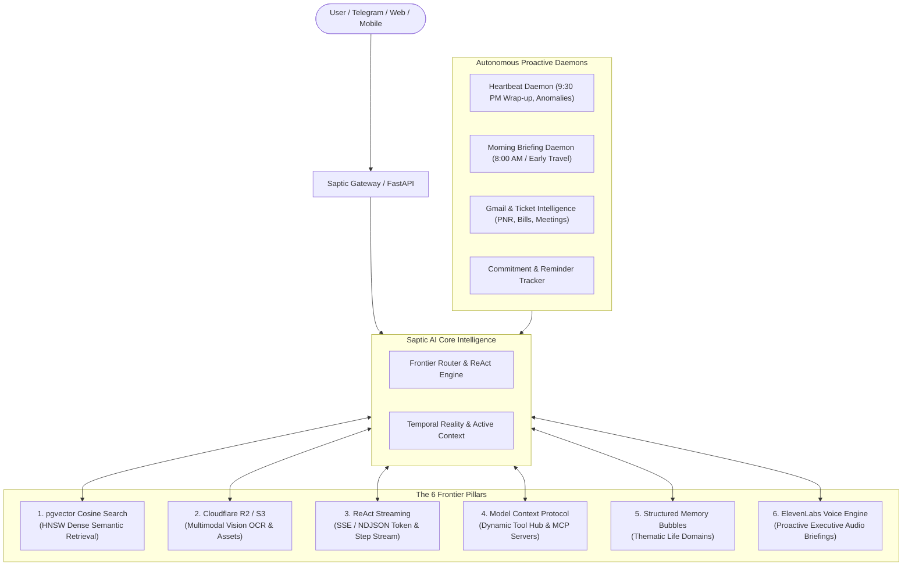

# Saptic AI — System Architecture & Capabilities Master Blueprint

```
   ███████╗ █████╗ ██████╗ ████████╗██╗ ██████╗     █████╗ ██╗
   ██╔════╝██╔══██╗██╔══██╗╚══██╔══╝██║██╔════╝    ██╔══██╗██║
   ███████╗███████║██████╔╝   ██║   ██║██║         ███████║██║
   ╚════██║██╔══██║██╔═══╝    ██║   ██║██║         ██╔══██║██║
   ███████║██║  ██║██║        ██║   ██║╚██████╗    ██║  ██║██║
   ╚══════╝╚═╝  ╚═╝╚═╝        ╚═╝   ╚═╝ ╚═════╝    ╚═╝  ╚═╝╚═╝
   Autonomous Executive Partner & Cognitive Operating System
```

---

## 1. Executive Summary & Vision

**Saptic AI** is an autonomous, proactive executive AI partner and personal cognitive operating system. Unlike traditional reactive chatbots (which sit idle waiting for commands), Saptic AI functions as a continuous, high-agency partner that understands time, remembers life facts across months, proactively tracks flights, tickets, bills, meetings, and habits, and reaches out autonomously when action is required.

Saptic AI is engineered to bridge the gap between instant conversational agility (Telegram, Web Companion, Voice) and enterprise-grade autonomous backend intelligence.

---

## 2. The 6 Frontier Architectural Pillars

Saptic AI incorporates the **Frontier Memorae 6-Pillar Architecture** for memory persistence, real-time reasoning, and multimodal tool execution:



### Pillar 1: pgvector Cosine Search Engine
- **Dense Vector Search**: Powered by 768-dimensional dense embeddings stored directly in PostgreSQL using `pgvector`.
- **HNSW / Cosine Indexing**: Instant sub-millisecond retrieval of memories, conversational context, entity facts, and commitments using cosine distance `<=>`.
- **Thematic Bubble Filtering**: Vector search scoped dynamically to life domains (Work, Travel, Health, Finance, Everything).

### Pillar 2: Cloudflare R2 / S3 Multimodal Asset Pipeline
- **Binary Asset Storage**: S3-compatible cloud object storage (Cloudflare R2 / AWS S3 with local filesystem fallback) for PDF tickets, medical receipts, invoices, and photo attachments.
- **Multimodal OCR & Vision**: Automatically scans uploaded images and documents using Llama-3.2-11b Vision to extract flight PNRs, hotel confirmations, blood test results, and utility bill due dates into structured memory.
- **SHA-256 Deduplication**: Eliminates duplicate document storage.

### Pillar 3: ReAct Step Streaming (SSE / NDJSON)
- **Granular Execution Transparency**: Streams step-by-step reasoning tokens directly to web & mobile clients over `/api/assistant/chat`:
  `Thinking` $\rightarrow$ `Searching (pgvector)` $\rightarrow$ `Checking (Timeline & Conflict Guard)` $\rightarrow$ `Executing (Tools)` $\rightarrow$ `Streaming Deltas` $\rightarrow$ `Complete`.
- **Zero-Latency Feel**: Users see what Saptic is searching, checking, or verifying in real time.

### Pillar 4: Model Context Protocol (MCP) Client Hub
- **Universal External Connectivity**: Standardized MCP integration (`/api/connectors/mcp`) allowing Saptic AI to discover, register, and invoke external tools and APIs dynamically.
- **Security & Neutralization Guardrails**: Full prompt-injection filtering and honest-failure verification before executing external tools.

### Pillar 5: Structured Memory Bubbles
- **Thematic Cognitive Spaces**: Organizes user memories into dedicated visual & logical bubbles:
  - 🌐 **Everything**: Universal aggregated memory view.
  - 💼 **Work**: Projects, deadlines, client meetings, GitHub issues, Notion docs.
  - ✈️ **Travel**: Flight tickets, train bookings, bus PNRs, hotel reservations, packing lists.
  - 🏥 **Health**: Fasting glucose, BP measurements, doctor appointments, medication schedules.
  - 💳 **Finance**: Credit card bills, utility payments, subscriptions, IPO status, expenses.
  - 🎨 **Custom Bubbles**: User-defined bubbles (e.g., `Research`, `Fitness`, `Family`) with custom hex colors and icons.

### Pillar 6: ElevenLabs Audio Briefing Engine
- **Lifelike Executive Voice Briefings**: Converts morning briefings, travel itineraries, and proactive alerts into studio-grade voice briefings.
- **Format Delivery**: MP3 audio streams delivered via Telegram voice notes or web companion audio player (`/api/assistant/tts`).

---

## 3. Autonomous Proactive Engines

Saptic AI does not wait for you to open the app. It runs autonomous background daemons that act on your behalf:

### 1. Autonomous Gmail & Ticket Intelligence Engine
- **Continuous Inbox Ingestion**: Polls connected Google accounts in the background.
- **Intelligent Classification**: Detects high-priority emails:
  - 🎫 **Ticket Bookings**: Airline confirmations (flight number, terminal, baggage allowance, PNR), IRCTC trains, bus bookings (seats, boarding point).
  - 💼 **Interviews & Meetings**: Automatically detects Google Meet, Zoom, or Teams links, companies, roles, and schedules calendar events.
  - 💳 **Bill Payments**: Detects bank credit card statements, Jio/Airtel/electricity bills, amounts due, and due dates.
  - 📄 **Critical Documents**: Identifies insurance policies, offer letters, or urgent requests.
- **Instant Telegram Ping**: Alerts the user immediately upon email arrival with actionable cards and schedules travel reminders automatically.

### 2. Proactive Morning Briefing Daemon
- **Evaluates Daily Agenda at 8:00 AM IST**:
  - Gathers Google Calendar meetings, Telegram reminders, smart list items, and commitments due today.
  - Fetches local weather forecasts (temperature, rain probabilities).
  - Detects schedule overlaps and time conflicts.
- **Early Travel Wake-Up Alerts**: If a flight or bus is scheduled before 9:00 AM, Saptic AI wakes you up **2 hours prior** with terminal guidelines, cab reminders, and route previews.

### 3. Proactive Evening Reflection & Wrap-up Daemon
- **9:30 PM Reflection**: Analyzes tasks accomplished during the day.
- **Pending List Review**: Checks smart lists (grocery, packing, to-do); if items remain unchecked, politely asks whether to mark them complete or carry them over to tomorrow.
- **Rest & Relaxation**: If all tasks are completed, sends a warm, personalized good-night wrap-up without nagging.

### 4. Continuous Temporal Reality Engine
- **Native IST Awareness**: Always operates in the user's real-world timezone (Indian Standard Time, Asia/Kolkata).
- **Phonetic & Relative Parsing**: Understands natural conversational timeframes (*"kal subah 10 baje"*, *"parso raat ko"*, *"agle somwar"*, *"7 nov ko shaam 5 bje"*).
- **Meeting Conflict Detection**: Checks Google Calendar and internal commitments before confirming a new meeting to prevent double-booking.

---

## 4. Cognitive Memory & User Personalization

| Memory Layer | Storage Mechanism | Functionality |
|---|---|---|
| **Episodic Context** | PostgreSQL `chat_logs` + SQLite | Full verbatim message history and turn-by-turn context |
| **Cognitive Facts** | `user_facts` | Extracted atomic facts (*"User prefers window seat"*, *"Fasting blood sugar is 86"*) |
| **Semantic Vectors** | `pgvector` (`embeddings`) | Dense vector representations for similarity search |
| **Entities & Relationships** | `entities` + `entity_aliases` | Phonetic and nickname matching (*"Ananya"*, *"Annaya"*, *"Devendra"*) |
| **Active Timeline** | `turn_traces` | Prevents hallucinations by tracking in-flight conversation state |
| **Commitments & Promises** | `commitments` + `contact_memories` | Tracks promises made to other people (*"Need to send deck to Rahul by Friday"*) |

---

## 5. Multi-Tenant Privacy & User Isolation (v2.3.1)

Saptic AI is engineered with zero-compromise multi-tenant privacy:
- **Strict Tenant Boundary**: Every Telegram Chat ID, phone number, and web verification session is strictly mapped to its own isolated database identity.
- **Zero Bleed Guarantee**: Alerts, Google OAuth tokens, tickets, and memories are never broadcast or shared across different accounts.
- **Dynamic Personalized Persona**: Always greets users by their real first name or chosen handle (`"Devendra"`, `"Peeps"`, `"Neerav"`), completely free of hardcoded assumptions or sycophancy.
- **End-to-End Encryption**: Google OAuth refresh tokens and sensitive integration keys are encrypted via Fernet AES-128-CBC before hitting disk.

---

## 6. Omnichannel Connectivity

Saptic AI is accessible across multiple touchpoints:
1. **Telegram Bot**: Conversational voice notes (Whisper STT), natural language Hinglish/English text, photo receipt OCR, document analysis.
2. **Web Companion & Modern Frontend**: Full dashboard featuring memory bubbles, interactive timeline spans, ReAct reasoning step visualizations, and live chat.
3. **Chrome / Edge Browser Extension**: One-click memory clipping of selected text, articles, or receipts directly into Saptic AI memory bubbles.
4. **Third-Party Integrations**:
   - 📅 **Google Workspace**: Calendar event sync, Gmail autonomous monitoring, Google Drive document uploads.
   - 📝 **Notion**: Automated database page creation and task syncing.
   - 🐙 **GitHub**: Issue tracking, repository listing, and developer project monitoring.
   - 🔌 **MCP Servers**: Extensible local or remote tool servers.

---

## 7. Core API Surface

| Endpoint | Method | Description |
|---|---|---|
| `/api/me` | `GET` | User profile, active timeline spans, connected integrations, version |
| `/api/assistant/chat` | `POST` | ReAct streaming conversation endpoint (SSE / NDJSON) |
| `/api/bubbles` | `GET / POST` | List or create structured memory bubbles |
| `/api/bubbles/{slug}/memories` | `GET` | Retrieve semantic memories filtered by bubble domain |
| `/api/memories/search` | `POST` | Dense cosine similarity vector search over pgvector |
| `/api/memories/upload` | `POST` | Ingest PDF, ticket, image, or receipt via R2/S3 storage & Vision OCR |
| `/api/assistant/tts` | `POST` | Synthesize lifelike speech via ElevenLabs audio engine |
| `/api/assistant/briefing/audio` | `GET` | Stream personalized morning executive audio briefing |
| `/api/connectors/mcp` | `GET / POST` | Dynamic Model Context Protocol tool discovery & registration |
| `/web/verification/*` | `POST` | Secure OTP authentication via phone and Telegram link |
