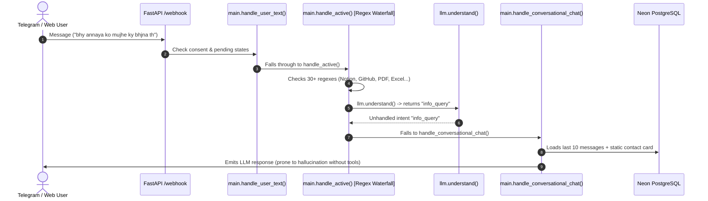

# Phase 0 Architecture & Codebase Audit: PeculiarAI

**Date:** October 21, 2026  
**Auditor:** Antigravity (DeepMind Advanced Agentic Coding)  
**Status:** Complete & Verified against live codebase

---

## 1. Executive Summary

This audit assesses the current state of **PeculiarAI** in preparation for the architectural migration to **V2 (Agent Core with Native Tool Calling + Layered Cognitive Memory + Zero-Unsupported-Claims Verifier)**.

The existing codebase contains strong foundation elements (AES-256-GCM token encryption, 104 green tests, working Google/Notion/GitHub API integrations, ReportLab/OpenPyXL document generators), but suffers from critical architectural fragility caused by:
1. A **2,000-line regex intent waterfall** in `main.py` that intercepts natural user queries before an LLM can understand them.
2. **Column-siloed, short-horizon memory** where information is lost if not tagged into a narrow database column, and the LLM only sees the last 8-10 messages.
3. **Point-in-time scheduling** that treats events as single points rather than intervals, failing to recognize conflicts like a 5 PM movie with a 6 PM meeting.
4. **In-memory multi-turn state** that drops pending actions upon cross-question interruptions or server restarts.

---

## 2. Current Request Flow & Dispatch Pipeline

### Where Intent is Decided Today:
1. `main.handle_user_text()`: Checks for Telegram slash commands (`/start`, `/reset`, `/export`, `/help`), pending state machines (`state == "create_meeting_details"`, `state == "persona_confirm"`), and `PENDING_GOOGLE_ACTIONS`.
2. `main.handle_active()`: Massive sequential `if/elif` block inspecting substrings for:
   - Notion integration tokens (`secret_`, `ntn_`)
   - Notion action keywords (`notion` + `add/save/note`)
   - GitHub keywords (`github`, `repo`, `repositories`)
   - Meeting link requests (`link`, `meet link`, `bhejo`)
   - Meeting follow-up times (`parsed_time_active`)
   - PDF creation (`pdf` + `bhej/banao`)
   - Excel export (`excel`, `csv`, `sheet`)
   - Business card text format
   - Contact commitment questions (`is_commitment_q`)
   - Document follow-ups (`is_recent_document_query`)
   - Sensitive data detection (`is_sensitive`)
   - Meeting deletion initiation (`_begin_meeting_deletion`)
3. `llm.understand()`: Calls Groq JSON mode with 18 enumerated intent categories.
4. `main.handle_conversational_chat()`: Final catch-all for any user input that passed all regexes without triggering an action.

---

## 3. Database Schema & Memory Storage Audit

Neon PostgreSQL currently hosts 13 tables:

| Table Name | Primary Purpose | Current Limitations |
| :--- | :--- | :--- |
| `users` | Base Telegram user metadata, persona, consented timestamp | OK. |
| `reminders` | Legacy reminder records | Distinct from `memory_items`, causing dual-table confusion. |
| `memory_items` | Categorized items & reminders with `due_date` and `due_time` | Relies on exact category taxonomy; lacks semantic vector embeddings. |
| `contact_memories` | Contact details, company, email, phone, commitments | Commitments stored as single flat text string per contact. |
| `chat_logs` | Full chronological message logs (`user_id, role, message`) | Stored as raw text without semantic vector embeddings or retrieval indexes. |
| `user_facts` | Extracted life facts and preferences | Contains facts, but lacked continuous background extraction pipeline. |
| `user_rules` | Behavioral user guidelines | Currently passive; rarely injected into agent prompts. |
| `smart_lists` / `smart_list_items` | Checklist & shopping lists | Fully functional. |
| `board_cards` | Kanban task cards (queue, this_week, today, done) | Fully functional. |
| `google_tokens` | Encrypted Google OAuth refresh/access tokens | Secure (AES-256-GCM / Fernet). |
| `user_integrations` | Encrypted third-party tokens (Notion, GitHub) | Secure (AES-256-GCM). |
| `email_links` | Verified forwarding email addresses for bills | Functional. |

### Extensions Verified:
- `vector` (pgvector): **Installed and verified on Neon DB**.
- `pg_trgm` (trigram fuzzy matching): **Installed and verified on Neon DB**.

---

## 4. LLM Call Sites & Model Inventory

1. **`llm._chat_json(system, user_text)`**: Central JSON-mode wrapper using `httpx.AsyncClient` calling Groq API.
2. **`llm.understand(message)`**: Structured intent classification.
3. **`llm.classify_yes_no_any_language(message, question_context)`**: Multilingual affirmative/negative classifier.
4. **`main.handle_conversational_chat()`**: Conversational responses with prompt-injected static contacts, recent items, and recent chat turns.
5. **`multimodal.process_telegram_photo()`**: Groq Vision call extracting business cards and bills.
6. **`voice.transcribe_telegram_voice()`**: Groq Whisper STT.

### Active Models Verified on Groq Key:
- `openai/gpt-oss-120b` (Primary reasoning & tool calling, natively supports OpenAI tool calling).
- `whisper-large-v3-turbo` (Speech-to-text).

---

## 5. Test Suite Inventory (104 Tests Total)

Current test coverage across 13 test files:
- `test_adversarial_and_security.py` (25 tests): Prompt injections, SQLi, sensitive data isolation.
- `test_api_v1.py` (14 tests): REST API v1 endpoints and CRUD operations.
- `test_master_repairs.py` (15 tests): Core state machine & regression tests.
- `test_crypto.py` (10 tests): AES-256-GCM token encryption and key rotation.
- `test_api_endpoints.py` (6 tests): Webhook validations and health checks.
- `test_nlu_and_parsing.py` (6 tests): Yes/no classifications and time parsing.
- `test_contact_and_schedule_intelligence.py` (5 tests): IST clock formatting, conflict warnings, fuzzy contact matching.
- `test_google_services.py` (4 tests): Calendar event creation and Drive uploads.
- `test_meeting_intelligence.py` (4 tests): Weekday parsing, dynamic rescheduling, meet links.
- `test_multimodal_documents.py` (4 tests): OCR and PDF Q&A.
- `test_oauth_security.py` (4 tests): CSRF state validation.
- `test_unified_memory_and_schedule.py` (4 tests): Multi-tier schedule aggregation.
- `test_integrations.py` (3 tests): Notion and GitHub live integrations.

**All 104 tests are currently passing (100% green).**

---

## 6. What to Delete, Keep, and Refactor

### Keep Intact (Do Not Break):
1. **Security & Crypto (`crypto.py`):** Token encryption at rest (AES-256-GCM), key derivation, and tamper detection.
2. **OAuth Subsystems (`google_auth.py`, `google_services.py`):** 3-legged OAuth flows, automatic token refresh, Google Calendar Meet injection, Drive uploads, Gmail sending.
3. **Third-Party Live Integrations (`integrations.py`):** Notion API client and GitHub client.
4. **Deterministic Date Math & Formatters (`timing.py`):** India Standard Time (`Asia/Kolkata`) handling, reminder calculation, `format_event_clock_ist()`.
5. **Document Generators (`file_generator.py`):** ReportLab PDF builder and OpenPyXL Excel builder.
6. **Multimodal Inputs (`multimodal.py`, `voice.py`):** Whisper voice transcription and Groq vision OCR.

### To Refactor / Replace with V2:
1. **Replace Regex Waterfall:** Replace the 2,000-line `if/elif` chain in `handle_active()` with `AGENT_CORE=v2` Tool-Calling Agent Loop (`agent/loop.py` & `agent/tools.py`).
2. **Upgrade Memory Architecture:** Introduce layered memory (L1 Working Memory with token budgeting, L2 Rolling Summary, L3 Vectorized Episodic Store in Neon `pgvector`, L4 Semantic Facts, and L5 Entity Graph).
3. **Upgrade Multi-Turn Pending Actions:** Move `PENDING_GOOGLE_ACTIONS` from volatile RAM dict to persistent PostgreSQL table `pending_actions` so actions survive server restarts and cross-question interruptions.
4. **Zero-Unsupported-Claims Verifier:** Implement `agent/verifier.py` to ensure every factual statement about the user's data is grounded in a retrieved memory record or tool execution result.
