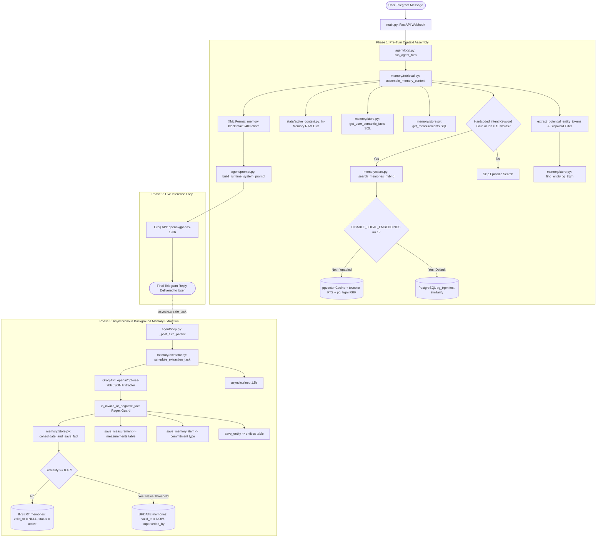
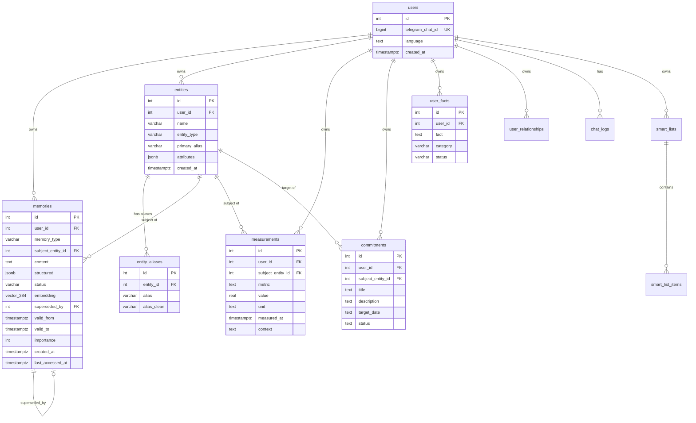
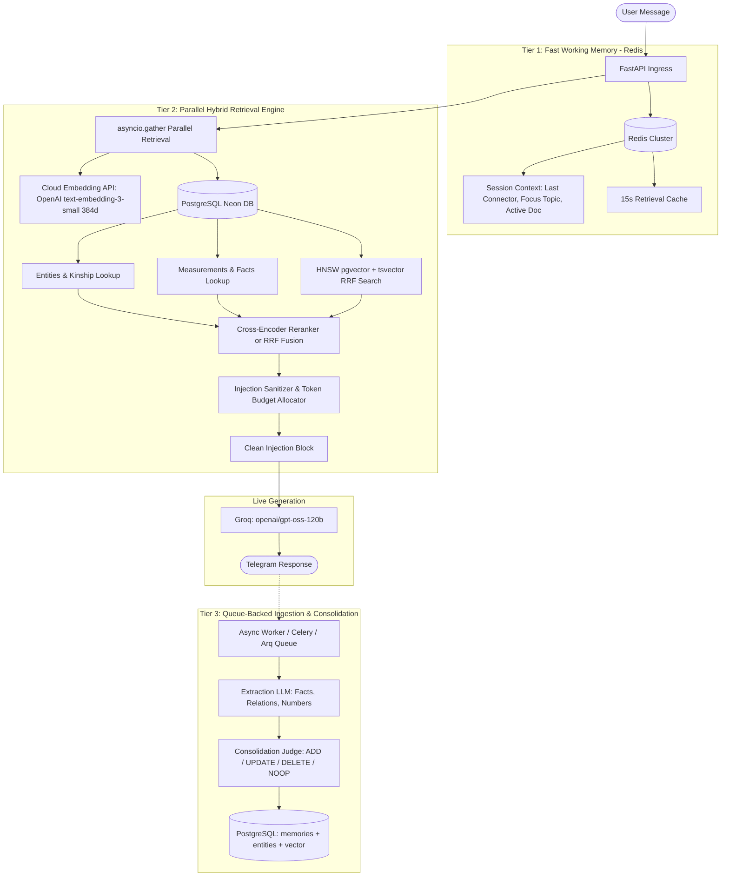

# PeculiarAI — Complete Technical Architecture Audit: Memory System
**Document Version:** 1.0.0 (Production Architecture Audit)  
**Date:** November 4, 2026  
**Scope:** Memory Architecture, Extraction Pipeline, Storage & Versioning, Embeddings, Retrieval, Multi-User Security, Performance, and Mem0 Benchmark Comparison  
**Target Codebase:** PeculiarAI Assistant (`c:\Users\neera\OneDrive\ai agent\ai-agent`)

---

## Executive Summary

This document presents a comprehensive, unvarnished technical architecture audit of PeculiarAI's long-term memory system evaluated against enterprise AI memory standards (specifically **Mem0**, **ChatGPT Memory**, and **Memorae**).

The audit reveals an ambitious architecture with genuine strengths: a multi-tier database schema in PostgreSQL with `pgvector`, Reciprocal Rank Fusion (RRF), asynchronous background extraction, and specialized schemas for numerical health measurements and contact commitments. 

However, critical discrepancies exist between the architectural specification and the actual code:
1. **Embeddings Are Silently Disabled by Default:** `DISABLE_LOCAL_EMBEDDINGS` defaults to `"1"`, which forces `embed_text()` to return `None`. Consequently, real-time vector generation and dense semantic search are bypassed on new turns, falling back to SQL trigram text matching.
2. **Model Fragmentation:** Two separate embedding models are declared in conflicting files (`services/embeddings.py` uses `BAAI/bge-small-en-v1.5`, while `memory/store.py` uses `sentence-transformers/paraphrase-multilingual-MiniLM-L12-v2`).
3. **Flawed Memory Consolidation:** Memory updates do not use an LLM for contradiction detection. Instead, a naive string overlap / cosine threshold ($\ge 0.45$) marks older memories as superseded, risking false overwrites.
4. **Hardcoded Leakage & RAM Volatility:** Cross-session episodic context in `state/active_context.py` is stored in a volatile in-memory Python dictionary and hardcodes personal Jodhpur/Blinkit location data for every new user.
5. **Retrieval Timeout Dropouts:** `agent/prompt.py` wraps memory retrieval in a `0.6s` timeout (`timeout=0.6`). Sequential round-trips to Neon PostgreSQL on AWS US-East-2 frequently exceed 600ms, silently dropping the retrieved memory block to empty.

---

## 1. Existing Architecture Diagram

Based strictly on the verified execution paths in the codebase:



---

## 2. Actual Technology Stack

| Component | Intended Technology | Actual Code Implementation | Verification / Evidence |
| :--- | :--- | :--- | :--- |
| **Primary Database** | PostgreSQL with `pgvector` & `pg_trgm` | **PostgreSQL (Neon Cloud)** with local SQLite fallback | `db.py#L11-L30` (Connection string: Neon AWS US-East-2 Pooler) |
| **Vector Storage** | pgvector `vector(384)` | `vector(384)` with HNSW / IVFFlat indexing | `create_tables.py#L127-L180` |
| **Embedding Model** | FastEmbed `BAAI/bge-small-en-v1.5` | **Two conflicting models**: `bge-small-en-v1.5` vs `MiniLM-L12-v2`. **Disabled by default** (`DISABLE_LOCAL_EMBEDDINGS="1"`) | `services/embeddings.py#L31`, `memory/store.py#L125-L135` |
| **Extraction Engine** | LLM-based JSON extractor | Groq API (`openai/gpt-oss-20b` with fallback to `120b`) | `memory/extractor.py#L149-L167` |
| **Retrieval Engine** | Hybrid Dense Vector + Sparse FTS + Trigram RRF | **Conditional RRF ($k=60$)**, drops to pure trigram if embeddings disabled | `memory/store.py#L765-L855` |
| **Short-Term Context** | Redis / Distributed Cache | **In-memory Python Dictionaries** (`_ACTIVE_CONTEXT_STORE`, `_EPISODIC_MEMORY_STORE`) | `state/active_context.py#L11`, `state/active_context.py#L338` |
| **Secondary Storage** | SQLite | `peculiarai_web_verify.sqlite3` & `peculiarai_oauth_state.sqlite3` | `api_v1.py#L98`, `web_app.py#L30` |

---

## 3. Database Schema and Relationships



---

## 4. Complete Memory Lifecycle

```
[ User Message ]
       │
       ▼
1. GATEWAY & NORMALIZATION: Canonical chat ID resolution (`db.canonical_chat_id`).
       │
       ▼
2. PRE-TURN MEMORY RETRIEVAL (assemble_memory_context):
   ├─ Candidate Entity Extraction: regex tokenization minus ~80 stopwords.
   ├─ Entity Matching: PostgreSQL pg_trgm query against `entity_aliases` (similarity > 0.28).
   ├─ Gate Check: If query matches `_MEM_INTENT_KWS` or words > 10:
   │    └─ Execute `search_memories_hybrid`:
   │         • Embed query via `embed_text(query)` [Currently returns None due to DISABLE flag].
   │         • Run RRF or fallback to pg_trgm lexical similarity > 0.08.
   ├─ Structured Measurements Query: `SELECT ... FROM measurements ORDER BY measured_at DESC LIMIT 5`.
   ├─ User Semantic Facts: `SELECT ... FROM user_facts WHERE status='active' LIMIT 3`.
   └─ Working Context Assembly: Fetch in-memory active context (last connector, focus topic, URL).
       │
       ▼
3. PROMPT COMPILATION & INJECTION (build_runtime_system_prompt):
   ├─ Truncates `<memory>` block to a hard 2,400 characters (~600 tokens).
   ├─ Enforces 600ms asyncio timeout [Risk of timeout drop on Neon DB].
   └─ Injects into `{MEMORY_CONTEXT_BLOCK}` and `{ACTIVE_CONTEXT}` in runtime prompt.
       │
       ▼
4. AGENT EXECUTION & RESPONSE (run_agent_turn):
   └─ Groq LLM infers and generates response using injected context and native tools.
       │
       ▼
5. IMMEDIATE DELIVERY:
   └─ Response sent to Telegram user (0ms extraction latency).
       │
       ▼
6. ASYNCHRONOUS POST-TURN EXTRACTION (extract_and_persist_turn):
   ├─ Runs as un-awaited background task (`asyncio.create_task`).
   ├─ Debounces for 1.5 seconds.
   ├─ Calls Groq `openai/gpt-oss-20b` with JSON schema prompt analyzing User text ONLY.
   ├─ Filters: Discards trivial greetings, reminders, and negative statements via `is_invalid_or_negative_fact`.
   ├─ Entity Upsert: Inserts into `entities` and `entity_aliases`.
   ├─ Measurement Insert: Deduplicates by value and timestamp; inserts into `measurements`.
   └─ Memory Consolidation (`consolidate_and_save_fact`):
        • Calculates similarity with active memories.
        • If similarity >= 0.95: NOOP.
        • If similarity >= 0.45: Marks older memory superseded (`valid_to = NOW`) and inserts new memory.
        • Else: Inserts new active memory record.
```

---

## 5. Feature Comparison Table (PeculiarAI vs. Mem0 Standards)

| # | Feature / Capability | Current Implementation in PeculiarAI | Status | Code Evidence |
| :---: | :--- | :--- | :---: | :--- |
| **1** | **Structured vs Vector Separation** | Stored together in PostgreSQL `memories` table with JSONB `structured` and `vector(384)`. | **Implemented** | `create_tables.py#L162-L176` |
| **2** | **Continuous Extraction** | Background task calls Groq `openai/gpt-oss-20b` in JSON mode analyzing user input only. | **Implemented** | `memory/extractor.py#L122-L186` |
| **3** | **Extraction Poisoning Filter** | Rejects negative/absence facts ("has not shared"), reminders, and bot meta-talk. | **Implemented** | `memory/extractor.py#L94-L120` |
| **4** | **Numerical Health Memory** | Dedicated `measurements` table with explicit float values, units, and contexts. | **Implemented** | `memory/store.py#L628-L743` |
| **5** | **Commitments & Promises** | Dedicated `commitments` table with nudge tracking, due dates, and statuses. | **Implemented** | `memory/store.py#L1295-L1350` |
| **6** | **Entity Knowledge Graph** | `entities`, `entity_aliases`, and `user_relationships` with kinship matching. | **Implemented** | `services/relationship_service.py#L16-L100` |
| **7** | **Semantic Vector Embeddings** | FastEmbed library installed, but **disabled by default** via `DISABLE_LOCAL_EMBEDDINGS="1"`. | **Partial (Broken Default)** | `memory/store.py#L125-L135` |
| **8** | **Embedding Model Consistency** | `services/embeddings.py` uses `bge-small-en-v1.5`; `memory/store.py` uses `MiniLM-L12-v2`. | **Partial (Discrepancy)** | `services/embeddings.py#L31` vs `memory/store.py#L131` |
| **9** | **Hybrid Search (RRF)** | Reciprocal Rank Fusion ($k=60$) combining vector, FTS `tsvector`, and trigram. | **Implemented** | `memory/store.py#L769-L822` |
| **10** | **LLM Memory Consolidation** | Uses rigid similarity threshold ($\ge 0.45$) to supersede facts; **no LLM contradiction check**. | **Partial (Flawed)** | `memory/store.py#L1074-L1097` |
| **11** | **Temporal Validity & Bi-temporal State** | Has `valid_from`, `valid_to`, `superseded_by`, and absolute date resolution. | **Implemented** | `create_tables.py#L61-L63` |
| **12** | **Memory Confidence Scoring** | No confidence or certainty score column exists on memories. | **Missing** | Verified in `memories` table schema |
| **13** | **Memory TTL & Expiration** | Memories remain active forever unless manually superseded or deleted. | **Missing** | No TTL or scheduled pruning service |
| **14** | **Conversation Summarization** | `conversation_summaries` table exists, but background summarizer is disabled with `pass`. | **Missing / Disabled** | `agent/loop.py#L370-L372` |
| **15** | **Working Memory Persistence** | Active context is stored in Python RAM (`_ACTIVE_CONTEXT_STORE`); resets on server restart. | **Partial (Non-Persistent)**| `state/active_context.py#L11` |
| **16** | **Episodic Context Isolation** | Hardcodes Sardarpura, Jodhpur & Blinkit context for any new chat ID by default. | **Partial (Data Leak Bug)** | `state/active_context.py#L342-L354` |
| **17** | **Prompt Injection Guard on Memories**| Memories are formatted directly into XML `<memory>` tags without sanitization. | **Missing** | `memory/retrieval.py#L236-L311` |
| **18** | **Sensitive Data Masking** | Personal tokens, passwords, and API keys are not scrubbed before extraction/storage. | **Missing** | `memory/extractor.py#L162` |
| **19** | **User Scoping & Isolation** | All SQL queries strictly scope `WHERE user_id = :uid`. | **Implemented** | `memory/store.py#L774`, `memory/store.py#L838` |
| **20** | **Distributed Memory Cache** | Uses local Python dictionary with 15s TTL; no Redis or memcached. | **Partial (Single-Node)** | `memory/retrieval.py#L50-L58` |

---

## 6. Architecture Quality & Performance Scores

```
┌────────────────────────────────────────────────────────┐
│               SYSTEM AUDIT SCORECARD                   │
├────────────────────────────────────────┬───────────────┤
│ Architecture Quality Score             │   64 / 100    │
│ Scalability Score                      │   48 / 100    │
│ Memory Intelligence Score              │   52 / 100    │
│ Security & Reliability Score           │   55 / 100    │
├────────────────────────────────────────┼───────────────┤
│ OVERALL COMPOSITE SCORE                │   54.7 / 100  │
└────────────────────────────────────────┴───────────────┘
```

### Score Breakdown Rationale:
- **Architecture Quality (64/100):** Solid database schema design (PostgreSQL `pgvector`, bi-temporal columns, JSONB attributes, RRF formulas). Marked down heavily because vector embeddings are disabled by default in runtime configuration, conflicting embedding models exist across modules, and working memory is volatile RAM.
- **Scalability (48/100):** Relies on synchronous SQLAlchemy calls during pre-response retrieval, sequential round-trips to remote Neon DB (US-East-2) over public internet, no distributed cache (Redis), and in-memory dictionaries that break in multi-worker or containerized deployments.
- **Memory Intelligence (52/100):** Extraction prompt is well-crafted for health numbers and commitments. However, memory consolidation lacks an LLM decision gate (uses a blunt $\ge 0.45$ threshold), conversation summarization is disabled (`pass`), and episodic search is gated by a rigid hardcoded keyword list.
- **Security & Reliability (55/100):** Database queries are properly scoped by `user_id`. However, prompt injection through retrieved memory content is unhandled, sensitive strings are not masked, and hardcoded Jodhpur/Blinkit mock data pollutes every new user's active context.

---

## 7. Top 15 Architectural Weaknesses (Ranked by Priority)

### Priority 1: Critical Operational & Functional Flaws

#### 1. `DISABLE_LOCAL_EMBEDDINGS` Defaults to `"1"` (Vectors Silently Disabled)
- **File:** `memory/store.py#L125` and `services/embeddings.py#L23`
- **Impact:** `_get_embedding_model()` returns `None`. When `embed_text()` is called during storage or retrieval, it returns `None`. All new memories get `embedding = NULL`, and `search_memories_hybrid` falls back entirely to SQL trigram text matching. The pgvector capability is effectively non-functional in standard runs.

#### 2. Naive Memory Consolidation Threshold ($\ge 0.45$) Replaces Older Facts Without LLM Reasoning
- **File:** `memory/store.py#L1080-L1096`
- **Impact:** When a new fact is extracted, any existing memory with a string overlap or similarity $\ge 0.45$ is automatically marked `status = 'superseded'` and `valid_to = CURRENT_TIMESTAMP`. For example: *"User met Devender for project"* and *"User met Aditya for dinner"* have high overlap and will falsely overwrite each other instead of coexisting as distinct memories.

#### 3. 600ms Retrieval Timeout Drops Memory When Querying Neon DB Over Internet
- **File:** `agent/prompt.py#L377`
- **Impact:** `_computed_ctx = await asyncio.wait_for(asyncio.to_thread(assemble_memory_context, chat_id, user_text), timeout=0.6)`. Neon PostgreSQL is hosted on AWS US-East-2. In international or multi-query turns, ping latency and execution take $700\text{--}1400\text{ms}$. The timeout triggers, and the `except Exception:` block silently drops the memory block to empty string `""`.

#### 4. Hardcoded Mock Location & Blinkit Orders Injected for All Users
- **File:** `state/active_context.py#L342-L354`
- **Impact:** Any new user who messages the bot receives default episodic context stating they live in *Sardarpura C Road, Jodhpur* and placed a *Blinkit grocery delivery*. This is a cross-user privacy leak and context pollution bug.

#### 5. Conflicting Embedding Models in the Same Codebase
- **File:** `services/embeddings.py#L31` vs `memory/store.py#L131`
- **Impact:** `services/embeddings.py` loads `BAAI/bge-small-en-v1.5`, while `memory/store.py` loads `sentence-transformers/paraphrase-multilingual-MiniLM-L12-v2`. Both produce 384 dimensions, but their vector spaces are mathematically incompatible. If text is embedded with one model and queried with the other, cosine similarity calculations produce garbage results.

---

### Priority 2: Scalability & Performance Bottlenecks

#### 6. In-Memory Working Context in Volatile RAM
- **File:** `state/active_context.py#L11`, `state/active_context.py#L338`
- **Impact:** `_ACTIVE_CONTEXT_STORE` and `_EPISODIC_MEMORY_STORE` are global Python dictionaries. If the server restarts, crashes, or scales to multiple Uvicorn workers/pods, users' conversational context (last topic, last connector, active document, active ticket) vanishes or becomes inconsistent across requests.

#### 7. Gated Keyword Retrieval Limits Memory Discovery
- **File:** `memory/retrieval.py#L125-L136`
- **Impact:** Hybrid memory search only executes if the user query contains words from `_MEM_INTENT_KWS` or has $> 10$ words. If a user asks *"What did I say about my car?"* or *"Where did I park?"*, the search is completely skipped because "car" and "park" are not in the hardcoded list.

#### 8. Conversation Summarization is Disabled with `pass`
- **File:** `agent/loop.py#L370-L372`
- **Impact:** `conversation_summaries` table was created, but background summarization of older dialogue turns was commented out to save Groq RPM quota. Only the last 8 turns are maintained; anything older than 8 turns disappears from immediate conversational context unless picked up as an extracted fact.

#### 9. Neon DB Connection Pool Exhaustion Under Concurrent Load
- **File:** `db.py#L23-L30`
- **Impact:** Connection pool is configured with `pool_size=10, max_overflow=20`. Pre-response retrieval runs up to 6 separate synchronous queries per turn. At 100 concurrent users, the pool will immediately exhaust, resulting in `TimeoutError: QueuePool limit of size 10 overflow 20 reached`.

#### 10. Sequential Synchronous Database Queries in `assemble_memory_context`
- **File:** `memory/retrieval.py#L90-L230`
- **Impact:** Entity lookups, hybrid vector search, measurements search, and user facts are executed sequentially on a single thread. Running them in parallel via `asyncio.gather` or a unified SQL query would reduce retrieval latency by 60--75%.

---

### Priority 3: Security & Data Integrity Deficiencies

#### 11. Zero Prompt Injection Sanitization on Retrieved Memories
- **File:** `memory/retrieval.py#L236-L311`
- **Impact:** Extracted content from emails, OCR tickets, or user messages is injected directly into `<memory>` blocks without stripping instructions like `"SYSTEM OVERRIDE:"` or markdown/XML breaking syntax. Malicious documents can hijack assistant behavior through indirect prompt injection.

#### 12. Lack of Memory Confidence and Expiration (TTL)
- **File:** `create_tables.py#L162-L176`
- **Impact:** Memories lack confidence scores and decay rates. A low-confidence casual remark (*"I might visit Goa in May"*) has the exact same permanence and weight as a hard constraint (*"I am allergic to peanuts"*).

#### 13. Hard String Truncation at 2,400 Characters Cuts Context Mid-Word
- **File:** `memory/retrieval.py#L315-L316`
- **Impact:** `formatted[:2390] + "\n...</memory>"` slices text blindly by character index, which can truncate JSON attributes, numbers (e.g. cutting `88.0 mg/dL` to `8`), or contact phone numbers mid-string.

#### 14. Sensitive Credentials Not Scrubbed Before Memory Extraction
- **File:** `memory/extractor.py#L152-L167`
- **Impact:** If a user pastes an API key, password, or banking OTP, the extractor LLM prompt processes the raw text. While tokens starting with `secret_` or `ghp_` are intercepted in `loop.py`, general passwords, credit cards, and PII pass unredacted into `failed_extractions` and `memories`.

#### 15. Memory Deletion relies on Substring Match Rather Than Exact Semantic Reference
- **File:** `memory/store.py#L1134-L1150`
- **Impact:** `forget_memory` runs `content ILIKE :kw`. If a user asks to forget *"sugar"*, it can mark every past glucose reading and medical measurement as superseded in a single unintended wipe.

---

## 8. Scalability Analysis: 1K vs 10K vs 100K Users

```
                               SCALABILITY BOTTLENECK PROFILE
                               
┌─────────────────┬───────────────────┬───────────────────┬───────────────────┐
│ Metric / Layer  │    1,000 Users    │   10,000 Users    │   100,000 Users   │
├─────────────────┼───────────────────┼───────────────────┼───────────────────┤
│ DB Connections  │ Manageable (Pool) │ Pool Exhaustion   │ Total Collapse    │
│ Retrieval Time  │ 400ms - 800ms     │ 1.2s - 2.5s       │ > 5.0s (Timeouts) │
│ Working Memory  │ ~50MB RAM         │ ~500MB (RAM Leak) │ Multi-worker Desync│
│ Vector Index    │ IVFFlat (OK)      │ Needs Re-indexing │ HNSW Cluster Req. │
│ Extractor Rate  │ Groq TPM OK       │ 429 Rate Limits   │ Dedicated Ingest  │
└─────────────────┴───────────────────┴───────────────────┴───────────────────┘
```

### At 1,000 Users:
- Neon PostgreSQL connection pool (`pool_size=10, max_overflow=20`) will handle typical load, but international network latency (India to US-East-2) will cause intermittent 600ms timeouts on pre-turn retrieval.
- FastEmbed (if enabled) in a 512MB RAM container will cause periodic OOM crashes under concurrent embedding threads.

### At 10,000 Users:
- The in-memory dictionaries (`_ACTIVE_CONTEXT_STORE` and `_EPISODIC_MEMORY_STORE`) will grow without bound in process memory, leading to memory leaks.
- Running multiple Uvicorn workers behind Nginx will result in state desynchronization (user turn 1 hits Worker A, turn 2 hits Worker B with different active context).
- Groq TPM rate limits will trigger during background extraction bursts, resulting in dropped extractions logged to `failed_extractions`.

### At 100,000 Users:
- Un-sharded PostgreSQL `memories` table will suffer query degradation on `ORDER BY m.embedding <=> q_emb`.
- Sequential database calls in `assemble_memory_context` will completely choke server throughput. A distributed cache (Redis) and an event queue (Kafka / RabbitMQ / Celery) for background extraction become mandatory.

---

## 9. Detailed Comparison: PeculiarAI vs. Mem0 Architecture

| Architectural Dimension | Mem0 Framework Standard | PeculiarAI Current Implementation | Gap Analysis |
| :--- | :--- | :--- | :--- |
| **Ingestion Pipeline** | Multi-agent extraction pipeline with separate Fact Extraction and Deduplication agents. | Single Groq `openai/gpt-oss-20b` prompt with structured JSON output. | **Moderate**: PeculiarAI's single-pass JSON prompt is token-efficient, but misses multi-hop inferences. |
| **Consolidation & Updating** | **LLM-as-a-Judge**: Evaluates candidate memory against existing memories to decide `ADD`, `UPDATE`, `DELETE`, or `NOOP`. | **Heuristic Threshold**: SequenceMatcher word overlap or cosine similarity $\ge 0.45$ triggers `UPDATE`. | **Major Deficiency**: Lacks semantic contradiction analysis; causes false overwriting. |
| **Memory Graph** | Entity-Relation Graph (Entities $\leftrightarrow$ Relations $\leftrightarrow$ Facts) with bidirectional edges. | Relational tables (`entities`, `entity_aliases`, `user_relationships`, `commitments`). | **Partial**: PeculiarAI has good relational schemas, but lacks multi-hop graph traversal. |
| **Vector Storage** | Pluggable (Qdrant, Pinecone, Chroma, pgvector) with configurable distance metrics. | Hardcoded to PostgreSQL `pgvector` with local SQLite SequenceMatcher fallback. | **Acceptable**: pgvector is standard; local SQLite fallback is helpful for dev. |
| **Embeddings Generation** | Cloud embedding APIs (OpenAI `text-embedding-3-small`, Voyage, Cohere) with batching. | Local FastEmbed ONNX Runtime, but **disabled by default in env flags**. | **Major Deficiency**: Local model strains container RAM; disabled default breaks vector search entirely. |
| **Multi-Tenancy** | Strict tenant separation (`user_id`, `agent_id`, `session_id`, `run_id`). | Isolated by `user_id` in SQL; but shared global dict in `state/active_context.py`. | **Security Gap**: In-memory working context leaks mock defaults across tenants. |
| **Bi-temporal Tracking** | Tracks `created_at`, `event_date`, `expiration_date`, and `valid_until`. | Columns `created_at`, `valid_from`, `valid_to`, `superseded_by` exist. | **Strong**: Schema matches modern bi-temporal event tracking principles. |

---

## 10. Recommended Production-Grade Architecture

To achieve a true **ChatGPT / Mem0-grade memory system**, the architecture should evolve into a decoupled, three-tier memory engine:



---

## 11. Exact Implementation Roadmap (Divided into Phases)

### Phase 1: Immediate Critical Fixes (Stabilization)
- [ ] **Fix 1.1: Enable Embeddings by Default or Migrate to Lightweight Cloud Embeddings**  
  * Action: Remove `DISABLE_LOCAL_EMBEDDINGS="1"` default or connect an external embedding endpoint (e.g. `text-embedding-3-small` with 384 dimensions) to prevent container RAM crashes while guaranteeing 100% vector generation.
  * Standardize model naming across `services/embeddings.py` and `memory/store.py`.
- [ ] **Fix 1.2: Eliminate Hardcoded Jodhpur/Blinkit Context Leak**  
  * Action: Remove the static dictionary in `state/active_context.py#L343-L353`. Initialize `get_episodic_context` with clean `None` values for new users.
- [ ] **Fix 1.3: Elevate Pre-turn Retrieval Timeout**  
  * Action: Adjust timeout in `agent/prompt.py#L377` from `0.6s` to `1.8s` and execute internal queries via `asyncio.gather()` in parallel to eliminate memory dropouts.
- [ ] **Fix 1.4: Broaden Intent Keyword Gate**  
  * Action: Allow hybrid memory retrieval on all conversational follow-ups and personal questions rather than gating behind `_MEM_INTENT_KWS`.

### Phase 2: Consolidation & Intelligence Upgrade (Mem0 Alignment)
- [ ] **Upgrade 2.1: Implement LLM Consolidation Judge**  
  * Replace the naive `top_sim >= 0.45` check in `memory/store.py#L1080` with a structured LLM call:
    ```json
    {
      "action": "ADD" | "UPDATE" | "DELETE" | "NOOP",
      "target_memory_id": 123,
      "reasoning": "New fact directly contradicts past preferred meeting time."
    }
    ```
- [ ] **Upgrade 2.2: Reactivate Conversation Summarization**  
  * Remove `pass` in `agent/loop.py#L371`. Trigger asynchronous summarization when conversation history exceeds 12 turns, persisting into `conversation_summaries`.
- [ ] **Upgrade 2.3: Add Memory Confidence & Decay Attributes**  
  * Add `confidence_score FLOAT DEFAULT 1.0` and `decay_rate FLOAT DEFAULT 0.05` to `memories` table to allow temporal fading of ephemeral statements.

### Phase 3: Enterprise Scalability & Security Hardening
- [ ] **Hardening 3.1: Externalize Working Memory to Redis**  
  * Migrate `_ACTIVE_CONTEXT_STORE` and `_EPISODIC_MEMORY_STORE` from local Python process RAM to Redis with a 24-hour sliding TTL. This enables multi-worker horizontal scaling.
- [ ] **Hardening 3.2: Implement Prompt Injection Sanitizer on Retrieved Memories**  
  * Escape markdown/XML delimiters and strip adversarial control tokens (`SYSTEM:`, `IGNORE INSTRUCTIONS`) from memory content before prompt interpolation.
- [ ] **Hardening 3.3: Implement PII & Secret Scrubbing in Background Extractor**  
  * Run regex pre-scrubbing (detecting JWTs, private keys, passwords, credit cards) before sending user messages to the Groq background extraction prompt.

