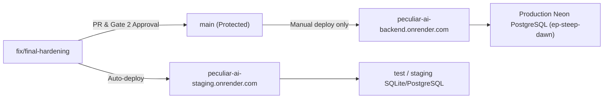
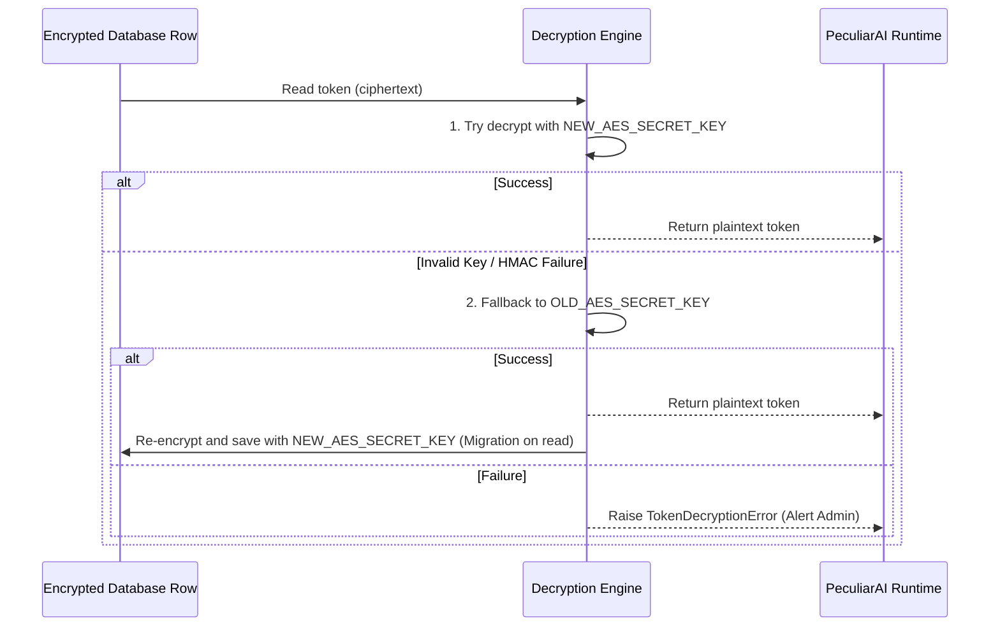

# PeculiarAI Deployment Hardening: Staging Setup & Secret Rotation Runbook

## Part 1: Render Staging Environment Setup

### 1. Architectural Topology
To prevent unintended deployments to the production environment (`peculiar-ai-backend.onrender.com`), production auto-deployment must be gated behind branch protection on `main`.



### 2. render.yaml Configuration Specification
Update `render.yaml` with dual-service topology:

```yaml
services:
  # -------------------------------------------------------------
  # Production Service (Protected, Manual Deployment)
  # -------------------------------------------------------------
  - type: web
    name: peculiar-ai-backend
    env: python
    region: oregon
    plan: starter
    branch: main
    autoDeploy: false # CRITICAL: Zero automatic deployments to production
    buildCommand: pip install --upgrade pip && pip install -r requirements.txt
    startCommand: uvicorn main:app --host 0.0.0.0 --port $PORT
    envVars:
      - key: AGENT_CORE
        value: v2
      - key: DATABASE_URL
        sync: false # Secure Neon PostgreSQL connection string
      - key: GEMINI_API_KEY
        sync: false
      - key: AES_SECRET_KEY
        sync: false

  # -------------------------------------------------------------
  # Staging Service (Automatic Preview for fix/* Branches)
  # -------------------------------------------------------------
  - type: web
    name: peculiar-ai-staging
    env: python
    region: oregon
    plan: starter
    branch: fix/final-hardening
    autoDeploy: true
    buildCommand: pip install --upgrade pip && pip install -r requirements.txt
    startCommand: uvicorn main:app --host 0.0.0.0 --port $PORT
    envVars:
      - key: AGENT_CORE
        value: v2
      - key: DATABASE_URL
        sync: false # Isolated Staging DB instance
```

---

## Part 2: Safe AES Secret Key Zero-Downtime Rotation Runbook

### 1. Threat & Need
`AES_SECRET_KEY` encrypts sensitive external tokens in the database (Google OAuth refresh tokens, Notion integration keys, GitHub personal access tokens). A key compromise or scheduled rotation must not invalidate existing credentials or cause user downtime.

### 2. Dual-Key Decrypt Algorithm (Zero-Downtime)
The rotation strategy implements dual-key lookup in `google_auth.py` and `db.py`:



### 3. Step-by-Step Operator Runbook
1. **Generate New Secret**:
   ```bash
   python -c "import secrets; print(secrets.token_urlsafe(32))"
   ```
2. **Deploy with Dual Keys**:
   Set environment variables in Render:
   - `AES_SECRET_KEY`: `<NEW_KEY>`
   - `AES_SECRET_KEY_FALLBACK`: `<OLD_KEY>`
3. **Execute Online Migration Batch Job**:
   ```bash
   python scripts/rotate_encryption_keys.py --old-env AES_SECRET_KEY_FALLBACK --new-env AES_SECRET_KEY
   ```
4. **Decommission Old Key**:
   Once all rows report `re-encrypted: 100%`, remove `AES_SECRET_KEY_FALLBACK` from Render settings.
